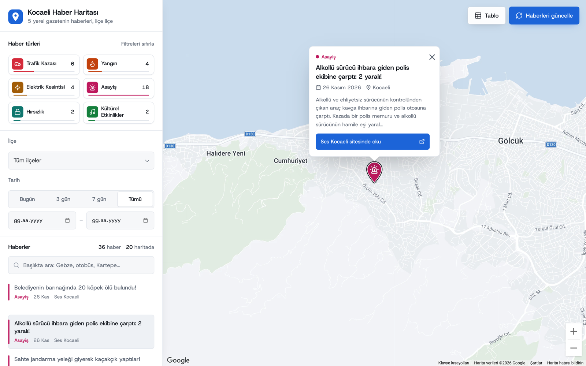
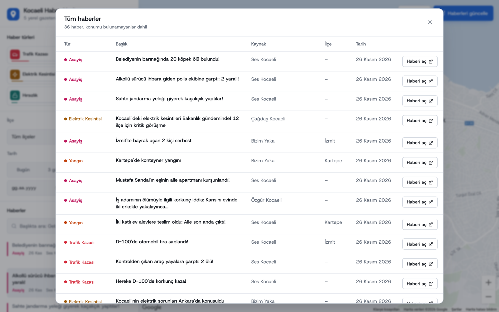
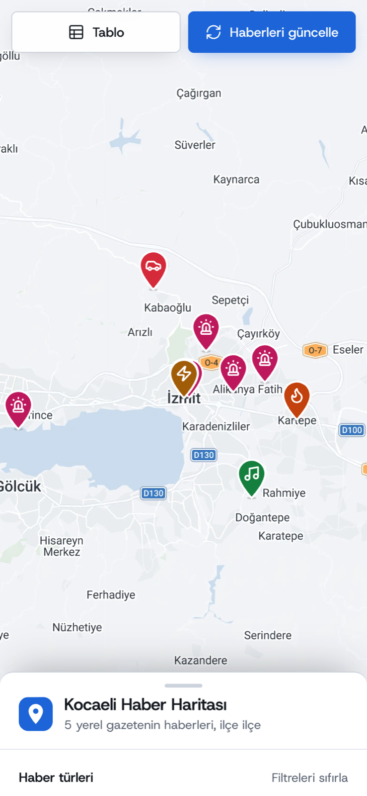

# 🗺️ Kocaeli Haber Haritası

**Web Scraping Tabanlı Kentsel Haber İzleme ve Harita Üzerinde Görselleştirme Sistemi**

Kocaeli Üniversitesi - Bilgisayar Mühendisliği Bölümü  
Yazılım Laboratuvarı-II | Proje I

---

## 📋 Proje Açıklaması

Bu proje, Kocaeli yerel haber sitelerinden belirlenen haber türlerine ait haberlerin web ortamından otomatik olarak toplanmasını, işlenmesini ve Google Maps üzerinde görselleştirilmesini sağlayan bir sistemdir.

## 📸 Ekran Görüntüleri



| Tüm haberler tablosu | Telefon |
|---|---|
|  |  |

## 🏗️ Mimari

```
┌─────────────────────────────────────────────────────┐
│                  Kullanıcı Arayüzü                  │
│              (HTML/CSS/JS + Google Maps)             │
├─────────────────────────────────────────────────────┤
│                   Flask Backend API                  │
├──────────┬──────────┬───────────┬───────────────────┤
│ Scraping │ Temizleme│Sınıfland. │ Konum & Geocoding │
│  Modülü  │  Modülü  │  Modülü   │     Modülü        │
├──────────┴──────────┴───────────┴───────────────────┤
│                  MongoDB Veritabanı                  │
└─────────────────────────────────────────────────────┘
```

## 🔧 Teknolojiler

| Teknoloji | Kullanım Alanı |
|-----------|----------------|
| **Python 3.10+** | Backend, Scraping, NLP |
| **Flask** | Web Framework & REST API |
| **MongoDB** | NoSQL Veritabanı |
| **BeautifulSoup4** | Web Scraping |
| **Sentence-Transformers** | Metin Benzerliği (Embedding) |
| **Google Maps API** | Harita Görselleştirme |
| **Google Geocoding API** | Koordinat Dönüştürme |

## 📰 Haber Kaynakları

- [Çağdaş Kocaeli](https://www.cagdaskocaeli.com.tr/)
- [Özgür Kocaeli](https://www.ozgurkocaeli.com.tr/)
- [Ses Kocaeli](https://www.seskocaeli.com/)
- [Yeni Kocaeli](https://yenikocaeli.com)
- [Bizim Yaka](https://bizimyaka.com)

## 📂 Haber Türleri

| Haber Türü | Pin Rengi |
|-----------|-----------|
| Trafik Kazası | Kırmızı `#F2555A` |
| Yangın | Turuncu `#F7934C` |
| Elektrik Kesintisi | Sarı `#F2C94C` |
| Asayiş | Pembe `#EC6FB0` |
| Hırsızlık | Turkuaz `#4FD1C5` |
| Kültürel Etkinlikler | Yeşil `#7BD88F` |

Her türün haritada kendi ikonu da var; tür sadece renge bağlı değil.

## 🎨 Arayüz

- Solda filtre paneli: tür chip'leri (filtre + lejant + dağılım tek yerde), ilçe, hızlı tarih (Bugün / 3 gün / 7 gün), başlıkta arama, sanal kaydırmalı haber listesi
- Sağda koyu temalı Google Maps; aynı konumdaki haberler çember üzerine dağıtılır
- "Tablo" ile konumu bulunamayanlar dahil tüm haberler
- Telefonda panel alttan açılan sheet olur
- Klavye ile kullanılabilir, `prefers-reduced-motion` destekli

## 🚀 Kurulum

### 1. Depoyu Klonlayın
```bash
git clone https://github.com/selimdogann/kocaeli-haber-haritasi.git
cd kocaeli-haber-haritasi
```

### 2. Sanal Ortam Oluşturun
```bash
python3.12 -m venv venv  # Python 3.12 ile test edildi
source venv/bin/activate  # macOS/Linux
# venv\Scripts\activate   # Windows
```

### 3. Bağımlılıkları Yükleyin
```bash
pip install -r requirements.txt
```

### 4. Ortam Değişkenlerini Ayarlayın
```bash
cp .env.example .env
# .env dosyasını düzenleyerek API anahtarlarınızı girin
```

### 5. MongoDB'yi Başlatın
```bash
# Docker ile (önerilen)
docker run -d --name kocaeli-haber-mongo -p 27017:27017 -v kocaeli-haber-mongo:/data/db mongo:7
```

### 6. Uygulamayı Başlatın
```bash
python app.py
```

Uygulama `.env` içindeki `FLASK_PORT` ile çalışır (varsayılan `http://localhost:5001`; macOS'ta 5000 portunu AirPlay kullanır).

Harita için `.env` dosyasına `GOOGLE_MAPS_API_KEY` girilmelidir. Anahtar yoksa liste ve filtreler çalışır, harita alanında uyarı görünür.

## 🧪 Testler

```bash
pip install -r requirements-dev.txt
pytest                 # internetsiz testler (sınıflandırma, scraper ayrıştırma, konum, API)
pytest --canli         # + 5 haber sitesine gerçekten bağlanan testler
```

- API testleri ayrı bir `kocaeli_haber_test` veritabanı kullanır; MongoDB çalışmıyorsa atlanır.
- Canlı testler her kaynaktan link toplanabildiğini, başlık/içerik/tarih çıkarıldığını ve linkin doğru habere gittiğini kontrol eder.

## ⚠️ Scraping notları

- Haber siteleri Cloudflare bot koruması kullanıyor. Kısa sürede çok istek atılırsa IP geçici olarak engellenir.
- Bu yüzden varsayılanlar kibar tutuldu: kaynak başına 2 paralel istek, istekler arası 1 sn (`SCRAPER_MAX_WORKERS`, `REQUEST_DELAY`).
- Veritabanında zaten olan haberlerin sayfası tekrar indirilmez.
- Bir site engellerse o kaynak o çalıştırmada atlanır ve arayüzde bildirim çıkar.

## 📁 Proje Yapısı

```
kocaeli-haber-haritasi/
├── app.py                    # Ana uygulama dosyası
├── config/
│   ├── __init__.py
│   └── settings.py           # Yapılandırma ayarları
├── scraper/
│   ├── __init__.py
│   ├── base_scraper.py       # Temel scraper sınıfı
│   ├── cagdas_kocaeli.py     # Çağdaş Kocaeli scraper
│   ├── ozgur_kocaeli.py      # Özgür Kocaeli scraper
│   ├── ses_kocaeli.py        # Ses Kocaeli scraper
│   ├── yeni_kocaeli.py       # Yeni Kocaeli scraper
│   └── bizim_yaka.py         # Bizim Yaka scraper
├── processing/
│   ├── __init__.py
│   ├── cleaner.py            # Veri temizleme
│   ├── classifier.py         # Haber sınıflandırma
│   ├── location_extractor.py # Konum çıkarımı
│   └── similarity.py         # Benzerlik analizi
├── database/
│   ├── __init__.py
│   └── mongodb.py            # MongoDB bağlantısı
├── geocoding/
│   ├── __init__.py
│   └── geocoder.py           # Geocoding işlemleri
├── static/
│   ├── css/
│   │   └── style.css
│   ├── js/
│   │   └── app.js
│   └── img/
├── templates/
│   └── index.html
├── requirements.txt
├── .env.example
├── .gitignore
└── README.md
```

## 📄 Lisans

Bu proje eğitim amaçlı geliştirilmiştir.

## 👤 Geliştirici

- **Selim Doğan** - Kocaeli Üniversitesi, Bilgisayar Mühendisliği
